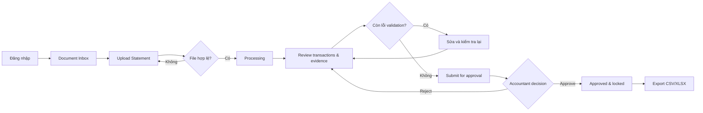
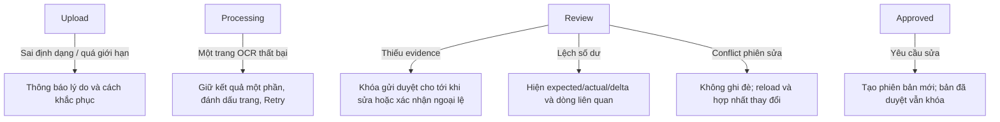

# Wireframe & UI Flow — StatementReader

**Đề tài:** IDP-13 · **Phiên bản:** 1.0 · **Ngày:** 15/11/2026

Tài liệu này mô tả luồng thao tác và wireframe mức khái niệm cho MVP. Hai ảnh có thể xem trực tiếp trên GitHub:

- [Tổng quan 6 màn hình](assets/wireframe-overview.png)
- [UI flow và các nhánh lỗi](assets/ui-flow.png)

## 1. Nguyên tắc thiết kế

- **Evidence first:** mọi giá trị tài chính cho phép quay lại đúng trang và vùng nguồn.
- **Exception first:** ưu tiên hiển thị dòng sai số dư, thiếu evidence hoặc confidence thấp.
- **Không tự động phê duyệt:** AI hỗ trợ trích xuất; người có thẩm quyền chịu trách nhiệm quyết định.
- **Trạng thái rõ ràng:** mọi tài liệu có trạng thái, người đang xử lý và hành động kế tiếp.
- **Progressive disclosure:** màn hình mặc định gọn, chi tiết kỹ thuật chỉ hiện khi người dùng cần.

## 2. Vai trò và quyền

| Vai trò | Quyền chính |
|---|---|
| Nhân viên ngân quỹ (Maker) | Tải tài liệu, theo dõi xử lý, sửa dữ liệu, xử lý ngoại lệ, gửi duyệt |
| Kế toán (Checker) | Xem tài liệu và lịch sử sửa, phê duyệt hoặc từ chối, xuất kết quả đã duyệt |

MVP không cho phép Maker tự phê duyệt tài liệu do chính mình gửi.

## 3. Happy path

## 4. Các nhánh lỗi chính

## 5. Đặc tả sáu màn hình

### S1 — Login

- **Mục tiêu:** xác thực người dùng và thiết lập vai trò cho phiên làm việc.
- **Thành phần:** email, mật khẩu, hiện/ẩn mật khẩu, đăng nhập, thông báo lỗi.
- **Trạng thái:** sai thông tin; phiên hết hạn; tài khoản không có quyền.
- **Quyền:** cả Maker và Checker.
- **PRD:** FR-01, NFR-04.

### S2 — Document Inbox

- **Mục tiêu:** tìm nhanh tài liệu cần hành động.
- **Thành phần:** tìm kiếm, bộ lọc trạng thái/ngày/người xử lý, bảng tài liệu, badge số lỗi, nút upload.
- **Trạng thái:** Uploaded, Processing, Needs review, Awaiting approval, Approved, Failed.
- **Hành động:** Maker mở tài liệu cần sửa; Checker ưu tiên hàng đợi chờ duyệt.
- **PRD:** FR-02, FR-03, FR-20.

### S3 — Upload Statement

- **Mục tiêu:** tải PDF/scan/ảnh và kiểm tra đầu vào trước xử lý.
- **Thành phần:** drag-and-drop, chọn file, thông tin định dạng/giới hạn, xác nhận dữ liệu tổng hợp, nút xử lý.
- **Trạng thái lỗi:** sai định dạng, file hỏng/mã hóa, quá dung lượng/trang, trùng file.
- **Quyền:** Maker.
- **PRD:** FR-04, FR-05, FR-21.

### S4 — Processing Progress

- **Mục tiêu:** cho biết hệ thống đang làm gì và kết quả nào đã sẵn sàng.
- **Thành phần:** tiến độ theo giai đoạn, tiến độ từng trang, thời gian đã chạy, Retry/Cancel.
- **Trạng thái lỗi:** OCR thất bại một trang; parser không tìm thấy bảng; timeout. Kết quả một phần được giữ và đánh dấu rõ.
- **Quyền:** Maker xem và retry; Checker chỉ xem.
- **PRD:** FR-06, FR-07, FR-08, FR-09, FR-10.

### S5 — Review Workbench

- **Mục tiêu:** đối chiếu tài liệu với giao dịch trích xuất trong ít thao tác nhất.
- **Bố cục:** tài liệu/PDF bên trái; bảng giao dịch bên phải; thanh issue và validation phía trên.
- **Tương tác:** chọn ô dữ liệu làm nổi vùng evidence; sửa inline; lọc confidence thấp; chuyển tới lỗi tiếp theo; lưu có version.
- **Trạng thái lỗi:** thiếu evidence, confidence thấp, lệch số dư, conflict khi hai người cùng sửa.
- **Quyền:** Maker sửa và gửi duyệt; Checker xem evidence/lịch sử nhưng không sửa trong phiên duyệt.
- **PRD:** FR-11 đến FR-17, NFR-05, NFR-06.

### S6 — Validation, Approval & Export

- **Mục tiêu:** đưa ra quyết định có kiểm soát và xuất kết quả đáng tin cậy.
- **Thành phần:** tổng hợp pass/fail, danh sách exception, audit history, Reject/Approve, lựa chọn CSV/XLSX.
- **Điều kiện:** chỉ gửi duyệt khi không còn lỗi blocking; Checker phải ghi lý do khi từ chối; chỉ tài liệu Approved được xuất bản chính thức.
- **Trạng thái Approved:** khóa bản ghi; hiển thị người và thời gian duyệt; chỉnh sửa bằng phiên bản mới.
- **Quyền:** Maker submit; Checker reject/approve/export.
- **PRD:** FR-18, FR-19, FR-20.

## 6. Bảng trạng thái quan trọng

| Tình huống | Cách hiển thị | Hành động khả dụng | Blocking? |
|---|---|---|---|
| File không hợp lệ | Banner đỏ, lý do cụ thể | Chọn file khác | Có |
| Trang OCR thất bại | Badge trang đỏ, kết quả một phần | Retry hoặc đưa vào review thủ công | Có trước khi duyệt |
| Dòng lệch số dư | Expected, actual và delta | Sửa dòng liên quan, revalidate | Có |
| Trường thiếu evidence | Icon liên kết bị đứt | Gắn lại evidence hoặc xác nhận ngoại lệ | Có |
| Hai người cùng sửa | Modal cảnh báo version conflict | Reload, so sánh và áp dụng lại | Có đối với lần lưu đó |
| Đã phê duyệt | Badge xanh, read-only | Export hoặc tạo phiên bản mới | Không |

## 7. Khả dụng và khả năng tiếp cận

- Không chỉ dùng màu để biểu diễn pass/fail; luôn có icon và nhãn chữ.
- Điều hướng issue bằng bàn phím; focus rõ; vùng bấm tối thiểu 40 px.
- Bảng hỗ trợ sticky header, virtualized rows và định dạng số nhất quán.
- Desktop từ 1280 px là mục tiêu MVP; màn hình nhỏ cho phép xem trạng thái nhưng không tối ưu thao tác review phức tạp.
- Mọi hành động phê duyệt, từ chối và export cần phản hồi thành công/thất bại rõ ràng.

> Wireframe là artifact thiết kế để thống nhất phạm vi, không phải ảnh chụp của sản phẩm đã triển khai.
